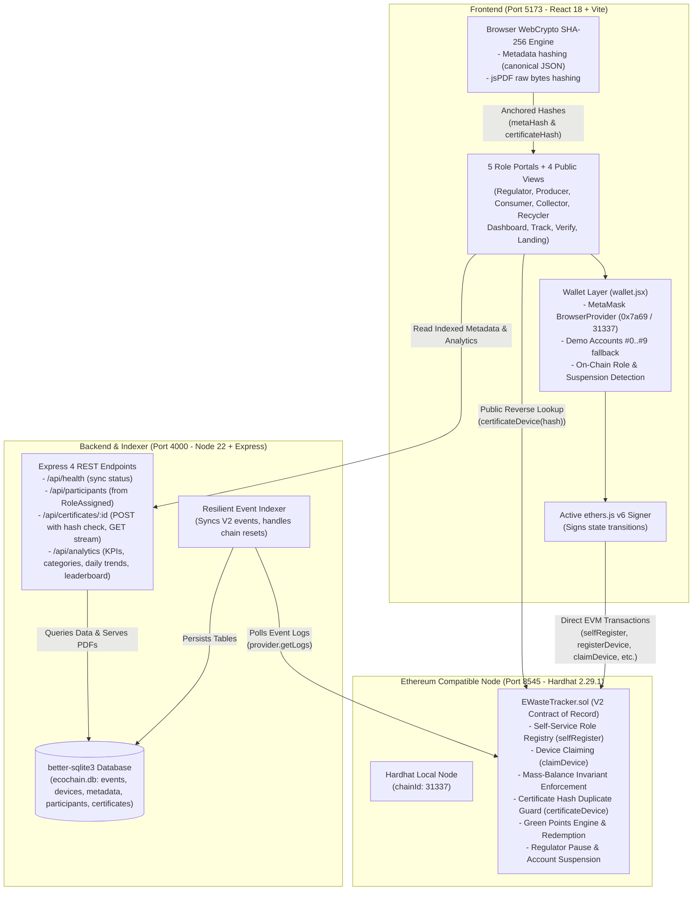
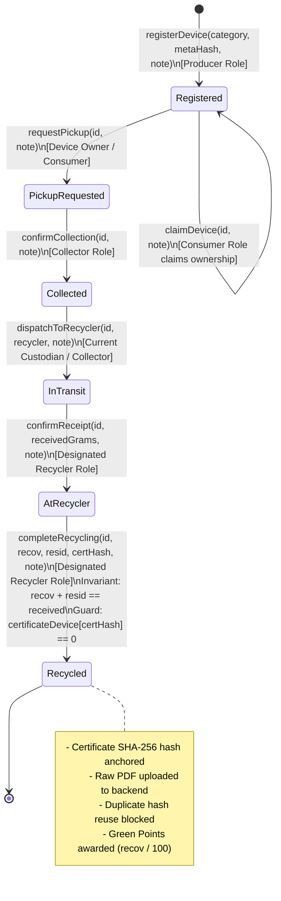
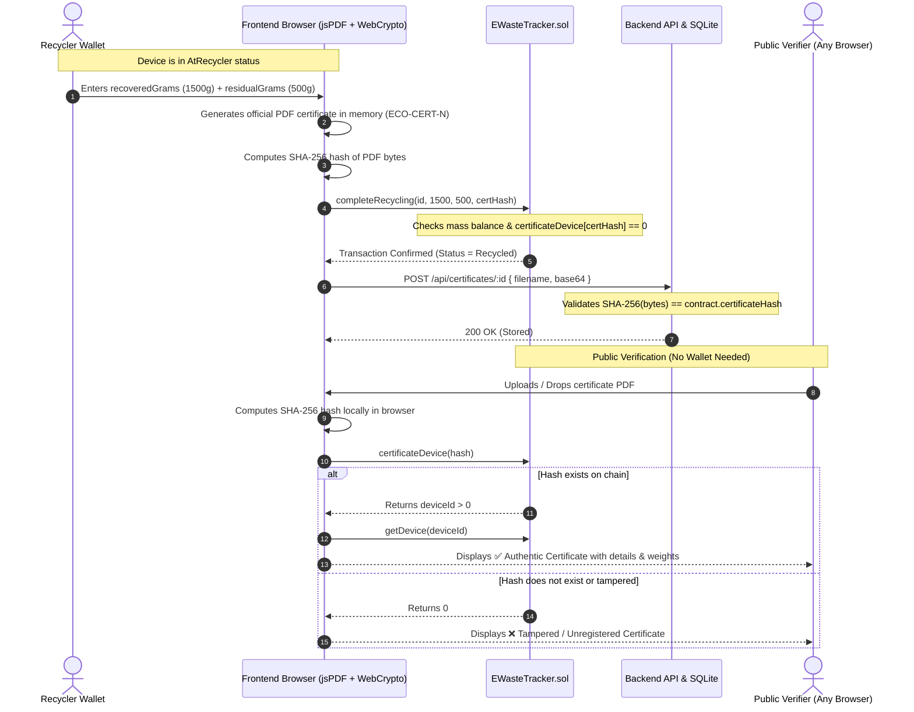

# EcoChain V2 System Architecture & Specification

## 1. System Architecture Diagram

---

## 2. E-Waste Lifecycle State Machine (V2)

---

## 3. Certificate Generation & Verification Sequence

---

## 4. On-Chain Role Matrix & Security Enforcements

| Role | Numerical ID | Onboarding Method | Primary Smart Contract Permissions |
| :--- | :---: | :--- | :--- |
| **None** | `0` | Default state for new wallets | Read-only queries (`getDevice`, `certificateDevice`, `getHistory`). Cannot send state transitions. |
| **Admin (Regulator)** | `1` | Deployer wallet (`msg.sender` in constructor) | `assignRole`, `setSuspended`, `setPaused`. Cannot change own role or suspend self. |
| **Producer** | `2` | `selfRegister(2)` or Admin override | `registerDevice`. Target for `redeemPoints`. |
| **Consumer** | `3` | `selfRegister(3)` or Admin override | `claimDevice`, `requestPickup`, `redeemPoints`. Receives Green Points. |
| **Collector** | `4` | `selfRegister(4)` or Admin override | `confirmCollection`, `dispatchToRecycler`. Acts as middleman logistics custodian. |
| **Recycler** | `5` | `selfRegister(5)` or Admin override | `confirmReceipt`, `completeRecycling` (anchors certificate hash & checks mass balance). |
