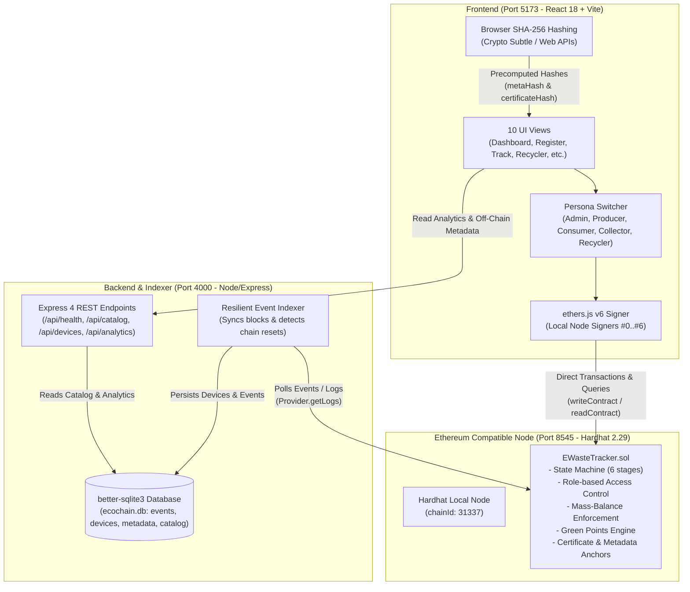
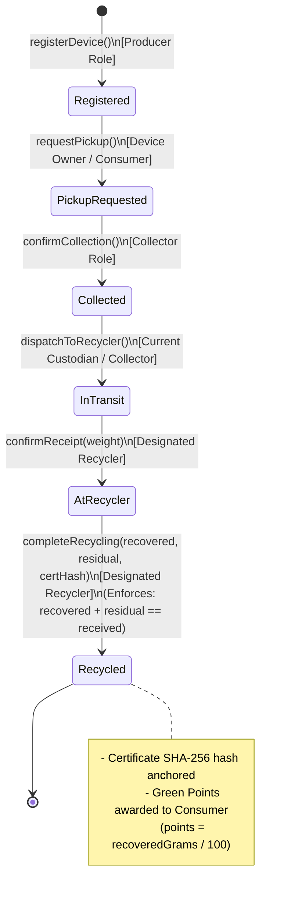

# EcoChain System Architecture & Diagrams

## 1. System Architecture Diagram

---

## 2. E-Waste Lifecycle State Machine

---

## 3. On-Chain vs. Off-Chain Data Storage Division

| Data Field | Storage Location | Security & Integrity Mechanism |
| :--- | :--- | :--- |
| **Device ID & Status (0..5)** | On-Chain (`EWasteTracker.sol`) | Immutable state machine with cryptographically enforced access control |
| **Custody & Ownership History** | On-Chain (`EWasteTracker.sol`) | Appended to `history` array on every validated transition |
| **Weights & Mass-Balance** | On-Chain (`EWasteTracker.sol`) | Smart contract assertion: `require(recovered + residual == received)` |
| **Certificate SHA-256 Hash** | On-Chain (`EWasteTracker.sol`) | Publicly verifiable via `verifyCertificate(deviceId, hash)` |
| **Metadata SHA-256 Hash** | On-Chain (`EWasteTracker.sol`) | Verified on-chain via `verifyMetadata(deviceId, hash)` |
| **Device Metadata (Name, Serial, Specs)** | Off-Chain (SQLite database) | Off-chain details can be altered, but any tampering mismatches on-chain `metaHash` |
| **E-Waste Catalog (7 Categories & Codes)**| Off-Chain (SQLite database) | Seeded from standard regulatory classifications (ITEW, CEEW, etc.) |
| **Historical Analytics & Aggregates** | Off-Chain (SQLite database) | Populated through continuous background indexing of blockchain event logs |
